## Main question
> How do we feed a sequence to a network,
>
> and predict the next state?

::: notes
Two new things today. First the architecture: recurrent networks, built for
sequences. Then the representation: a word is not a number, so how do we give it to
the network? Last session we trained CBOW and got word embeddings as a by-product;
today we use them, and ask whether they are worth the trouble.
:::

## Sequences types

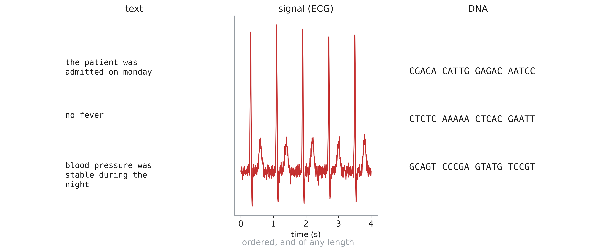

::: notes
Clinical notes, ECG, EEG, vital signs over a hospital stay, DNA. Two properties: the
order matters (shuffle the words of a sentence, the meaning is gone), and the length
varies from one example to the next.
:::

## Dense networks are not for sequences

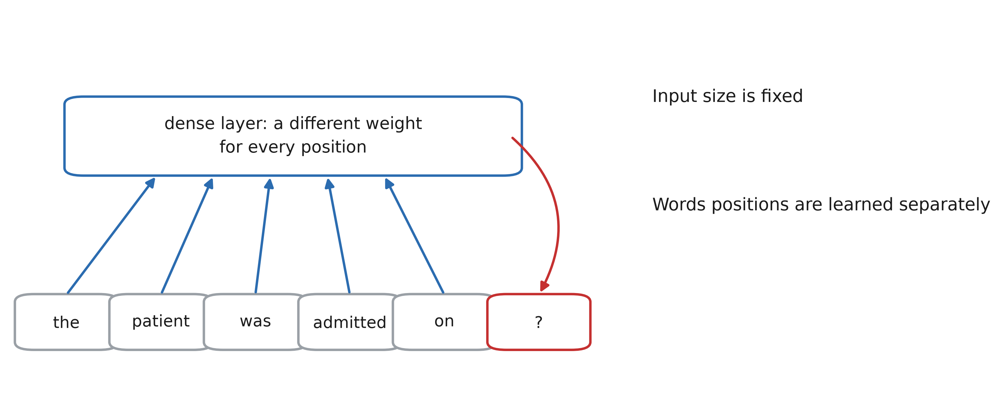

::: notes
We could take a fixed window of the last 5 words and feed it to a dense network.
Three problems. The input size is fixed. Each position has its own weights, so what
is learned about a word at position 4 does not transfer to position 2 — the same
issue convolutions solve for images (share the weights across positions). And nothing outside the window can ever be used.
:::

# Recurrent neural networks

## The recurrent cell

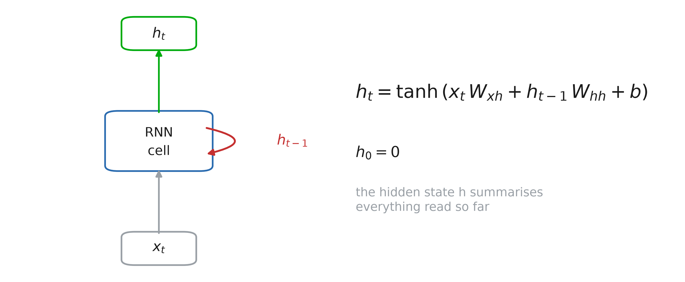

::: notes
Read the sequence one element at a time, and keep a memory: the hidden state h. At
each step, the new state is computed from the current input and the previous state.
The hidden state is a fixed-size summary of everything read so far — whatever the
length of the sequence.
:::

## Unrolled in time

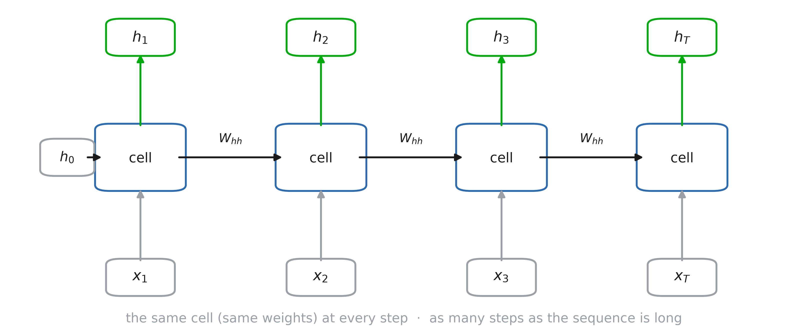

::: notes
Unrolled, an RNN is just a deep network with one layer per time step — but every
layer shares the same weights W_xh, W_hh, b. So the number of parameters does not
depend on the length of the sequence, and what is learned at step 3 is used at step
30. Same idea as a convolution, along time instead of space.
:::

## Tasks variations

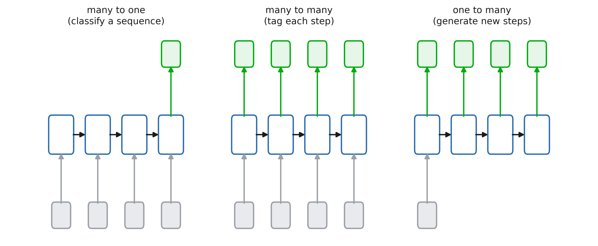

::: notes
Many to one: read the whole sequence, use the last state (sentiment of a review,
arrhythmia from an ECG). Many to many: an output at every step (next word, part of
speech of each word). One to many: generation. Today: many to many, the next word at
every position.
:::

## RNN from scratch: layers

```python
class torch.nn.RNN(nn.Module):
    def __init__(self, d_in, d_h,
                 act=torch.tanh):
        super().__init__()
        self.d_h, self.act = d_h, act
        self.x2h = nn.Linear(d_in, d_h)
        self.h2h = nn.Linear(d_h, d_h)
```

::: notes
Code along. Two linear layers: x2h computes x_t W_xh, h2h computes h_{t-1} W_hh. Each
has its own bias; one would be enough (they are added together), but PyTorch's
nn.RNN also has two, which makes the comparison two slides from now exact. The
activation is a parameter: tanh by default, we will try ReLU in a moment.
:::

## RNN from scratch: predictions

```python
    def forward(self, x):  # [B, T, d_in]
        B, T, _ = x.shape
        h = torch.zeros(B, self.d_h)
        outs = []
        for t in range(T):
            h = self.act(self.x2h(x[:, t])
                         + self.h2h(h))
            outs.append(h)
        return torch.stack(outs, 1), h

rnn = RNN(5, 7)
# total parameters: 5×7 + 7 + 7×7 + 7 = 98
```

::: notes
h_0 = 0, then the same two layers at every step. The for loop is the point: step t
needs h_{t-1}, so the steps cannot run in parallel. We return every hidden state
(for many-to-many tasks) and the last one (for many-to-one).
:::

## PyTorch example

```python
rnn = nn.RNN(input_size=100,
             hidden_size=256,
             batch_first=True)

x = torch.randn(64, 32, 100)
# 64 sequences, 32 steps, 100 features
outputs, h_last = rnn(x)
outputs.shape  # [64, 32, 256]
h_last.shape   # [1, 64, 256]
```

::: notes
`batch_first=True` puts the batch dimension first, like everywhere else in the
course (the default is time first, for historical reasons). `outputs` holds the
hidden state at every step, `h_last` the last one (with an extra dimension for the
number of stacked layers). From now on we use the built-in layers: same numbers as
our for loop, much faster.
:::

## Back-propagation through time

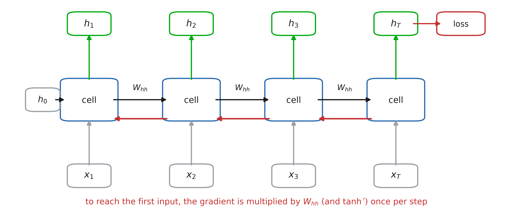

::: notes
Training: compute the loss, backpropagate through the unrolled network. Nothing
new — autograd does it — but the gradient that reaches the first steps went through
T multiplications by W_hh and by tanh'. Also: the steps cannot run in parallel
(step t needs step t − 1), so RNNs are slow on long sequences. That is one reason
transformers replaced them.
:::

## Vanishing and exploding gradients

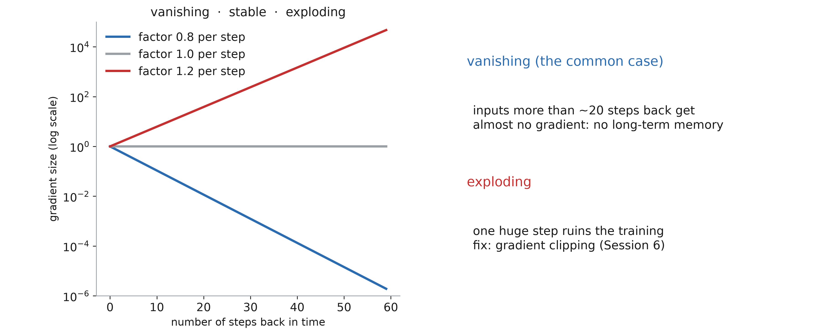

::: notes
A product of T numbers: if they are below 1, it shrinks exponentially; above 1, it
explodes. Exploding: one huge step ruins the training — gradient clipping, seen in
Session 6, the figure was about RNNs. Vanishing is worse because it is silent: the
network trains, but it never learns to use anything more than ~20 steps back.
Bengio, Simard, Frasconi (1994); Pascanu, Mikolov, Bengio (2013).
:::

## How far back does the gradient reach?

```python
for act in [torch.tanh, torch.relu]:
    for scale in [1, 2, 4]:
        torch.manual_seed(0)
        x = torch.randn(1, 100, 8,
                        requires_grad=True)
        rnn = MyRNN(8, 32, act)
        with torch.no_grad():
            rnn.h2h.weight *= scale
        _, h = rnn(x)
        h.sum().backward()
        grad = x.grad[0].norm(dim=1)
        plt.semilogy(grad)  # one value per t
```

::: notes
grad[t] measures how much the input at time t influences the last state h_T: it is
the signal training gets to learn a dependency from t to T. Default weights (the
initialisation of nn.Linear, which is also nn.RNN's), then h2h weights doubled and
quadrupled; for tanh and for ReLU. Ask the room before the next slide: what shape
do you expect, on a log scale? What changes with the scale? With ReLU?
:::

## How far back does the gradient reach?

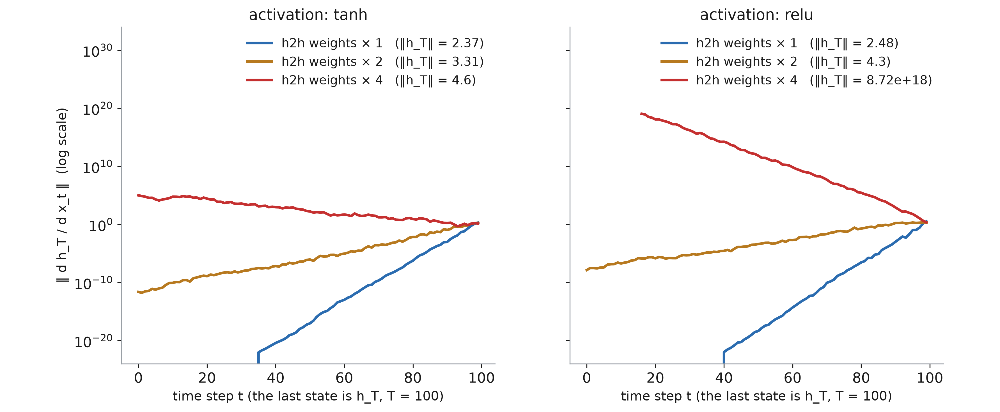

::: notes
Default weights (blue): a straight line on a log scale, so exponential decay; 60
steps back the gradient is 10^20 times smaller, then exactly zero in float32. ×2
(orange): slower decay, still 10^11 times smaller after 100 steps. ×4 (red): it
explodes going back in time. ReLU (right) behaves the same for the gradient — but with ×4 the
state itself explodes: ‖h_T‖ = 10^19, while tanh keeps every coordinate in (−1, 1),
so ‖h_T‖ ≤ √32 ≈ 5.7. Next slide: why it is exponential.
:::

## Why tanh, not ReLU?

- The same layer is applied T times
- ReLU is unbounded: the state itself can explode
- tanh keeps the state in (−1, 1) but gradients vanish


::: notes
In feed-forward networks ReLU won, but each layer has its own weights there. In an
RNN the same map is applied again and again: if W_hh amplifies the state even
slightly, a ReLU state grows exponentially (the ×4 curve: 10^19). tanh bounds it,
and is centred on 0, while ReLU outputs are ≥ 0 and drift upwards. The cost: tanh'
≤ 1, and close to 0 when saturated, which feeds the vanishing gradient. ReLU RNNs
exist (nn.RNN(..., nonlinearity="relu")), with W_hh initialised close to the
identity (Le, Jaitly, Hinton, 2015). GRU and LSTM keep bounded functions: tanh for
the state, sigmoid for the gates.
:::

## Long-term memory: the intuition

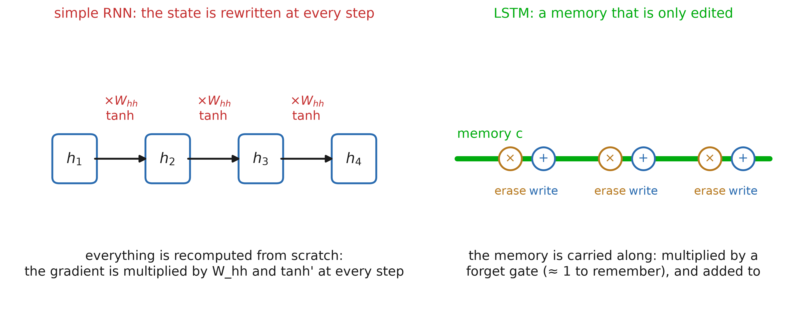

::: notes
A simple RNN rewrites its whole state at every step: like a whiteboard you must
recopy entirely, through a distortion, each time you add something. After 50 copies
nothing is left of the first line — and the gradient, which goes back through the
same copies, vanishes. The LSTM idea (Hochreiter & Schmidhuber, 1997): keep a
separate memory c, carried along a straight line, and only edit it — erase a
little, write a little. If nothing is erased, the memory (and its gradient) goes
through unchanged. Example: "The patients who were admitted on Monday after the
accident ... were": the plural must survive many words.
:::

## Gate: soft switch

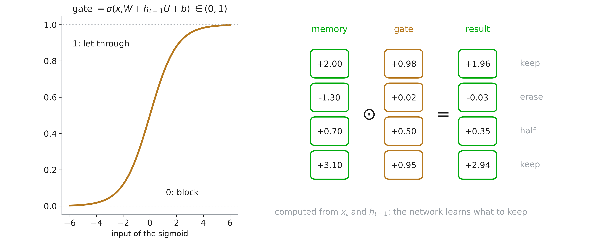

::: notes
How does the network decide what to erase or write? With gates: a vector of numbers
between 0 and 1 (a sigmoid), computed from the current input and the previous state,
multiplied element-wise with what it controls. 1 lets through, 0 blocks, and each
coordinate is decided separately. A gate is differentiable, so when to keep and when
to erase is learned by gradient descent like any other weight.
:::

## The LSTM cell

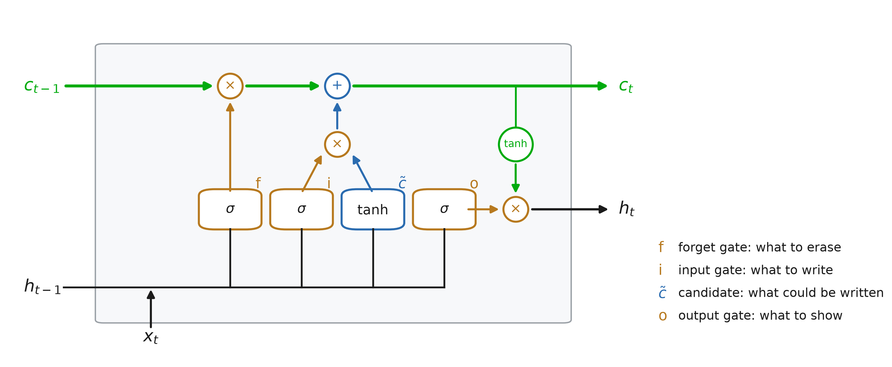

::: notes
Top: the memory line. It is multiplied by the forget gate f (erase), then the input
gate i times the candidate c~ is added (write). Bottom: the four boxes all read the
same inputs, h_{t-1} and x_t: three sigmoids (gates) and one tanh (candidate, the
same formula as a simple RNN). Right: the new state h_t is a tanh of the memory,
filtered by the output gate o. Two states go to the next step: c_t and h_t.
:::

## LSTM: the equations

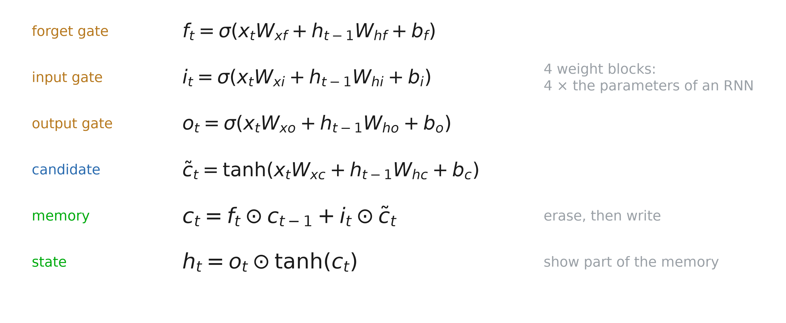

::: notes
Each gate is a small layer of its own, with the same form as a simple RNN: four
weight blocks instead of one, so four times the parameters for the same hidden size.
The forget gate was not in the 1997 paper; it was added by Gers, Schmidhuber and
Cummins (2000), and it is the one that makes LSTMs work in practice.
:::

## Why the gradient survives

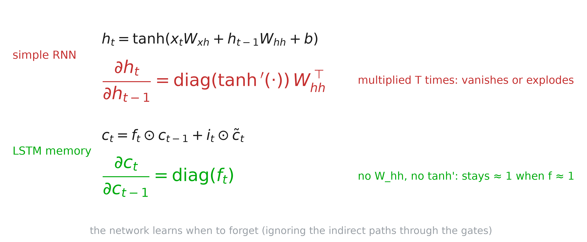

::: notes
Compare with the simple RNN, where each step back multiplies the gradient by W_hh
and by tanh' (both usually small). Along the memory line, each step back only
multiplies by f_t, and the network can learn f_t ≈ 1 for whatever must be kept: the
gradient survives hundreds of steps (ignoring the indirect paths through the gates).
It is the same trick as the skip connections of ResNets: an additive path.
Exploding gradients are still possible: keep gradient clipping.
:::

## GRU: a simpler LSTM

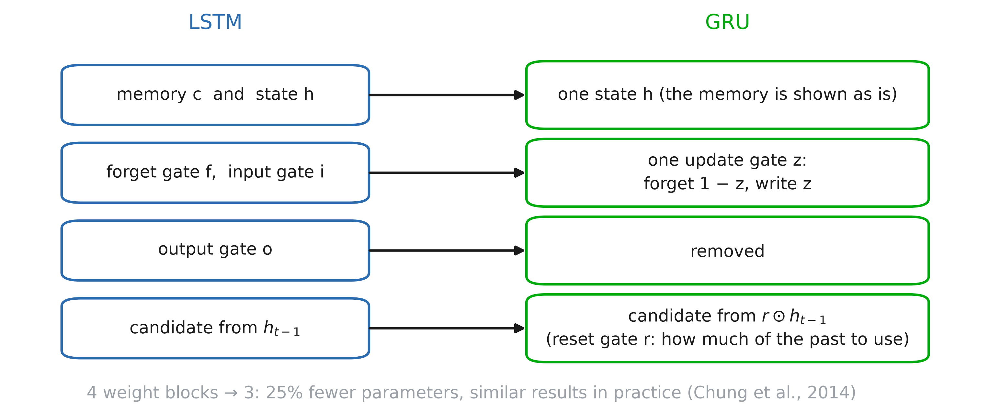

::: notes
Cho et al. (2014) kept the idea — an additive, gated path through time — and made it
simpler. One state instead of two. One update gate z for erasing and writing at
once: what is written replaces exactly what is erased (keep 1 − z of the old state,
write z of the new). No output gate. And a reset gate r, which lets the candidate
ignore the past (r ≈ 0) when something new starts. Chung et al. (2014) found no clear
winner between the two.
:::

## The GRU cell

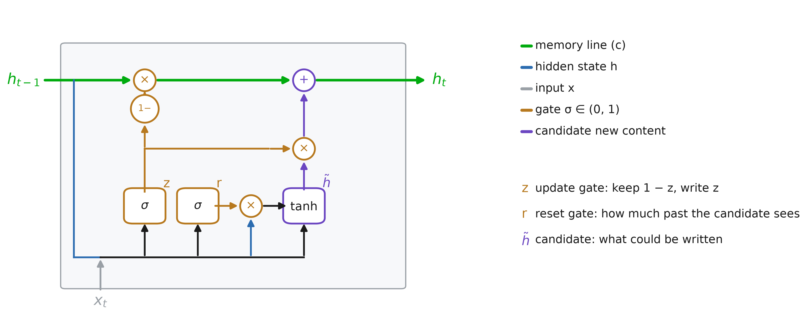

::: notes
Same colours as the LSTM. The top line is now the state itself: it plays the role of
the LSTM memory. The update gate z feeds two branches: 1 − z multiplies the old state
(keep), z multiplies the candidate (write) — erasing and writing are tied. The reset
gate r filters h_{t-1} before the candidate sees it: r ≈ 0 means "start afresh". No
output gate, no tanh on the way out: the state is shown as is.
:::

## GRU: the equations

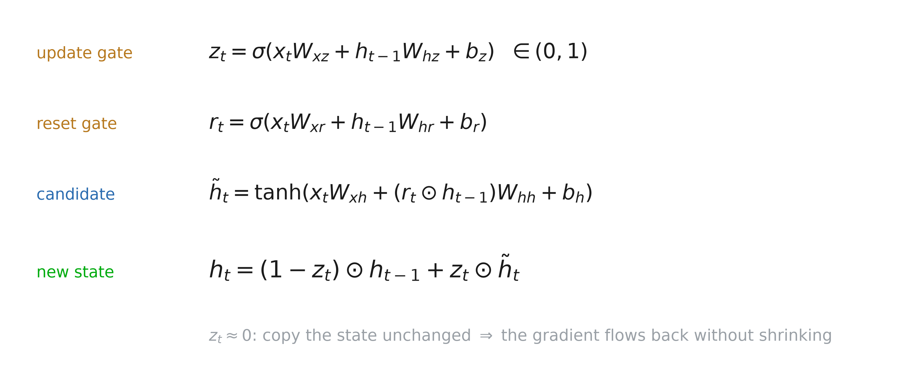

::: notes
The update gate z is between 0 and 1. When z ≈ 0 the state is copied unchanged, so
the gradient flows back without being multiplied by anything small: the memory line
of the LSTM, without a separate memory.
:::

## LSTM vs GRU: the cells

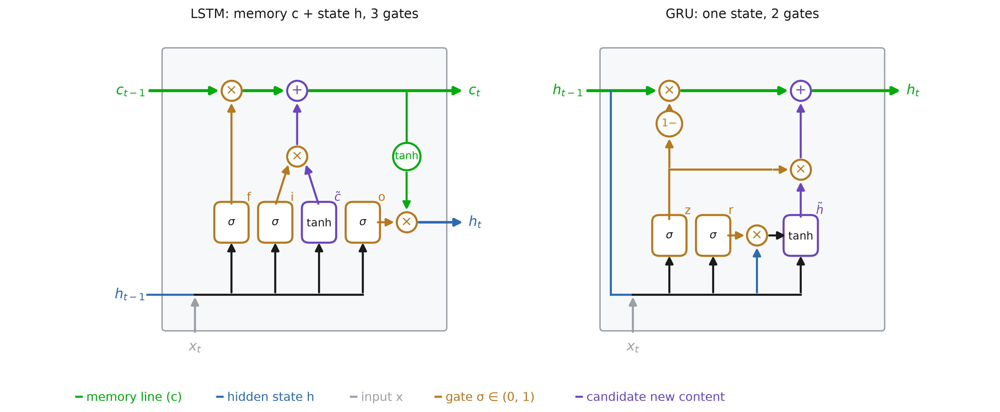

::: notes
Same frame, same colours. Both keep a green line that is only multiplied by a gate
and added to — that is what lets the gradient through. The LSTM has a separate memory
c and shows part of it as h (output gate); the GRU merges them. The LSTM erases (f)
and writes (i) independently; the GRU ties them (1 − z and z). The GRU's reset gate
has no LSTM counterpart.
:::

## LSTM vs GRU: the equations

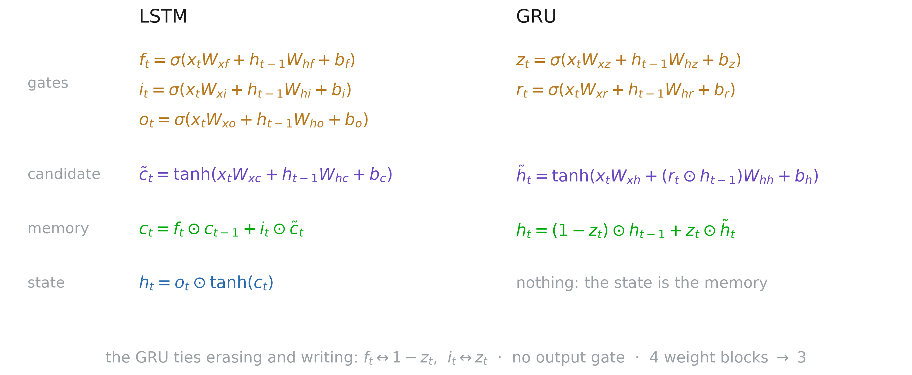

::: notes
Row by row. Gates: three for the LSTM, two for the GRU. Candidate: the same tanh
layer, except that the GRU's sees r ⊙ h_{t-1}. Memory update: f and i in the LSTM,
1 − z and z in the GRU. State: the LSTM filters its memory through o and a tanh; the
GRU has nothing to do. Four weight blocks against three: 25% fewer parameters.
:::

## LSTM and GRU in PyTorch

```python
x = torch.randn(64, 32, 100)
lstm = nn.LSTM(100, 256,
               batch_first=True)
gru = nn.GRU(100, 256,
             batch_first=True)
out, (h, c) = lstm(x)
out, h = gru(x)

# LSTM h, c: [1, 64, 256]
# LSTM W_hh: [1024, 256] (4 blocks)
# GRU  h:    [1, 64, 256]
# GRU  W_hh: [768, 256]  (3 blocks)

```

- Parameters: LSTM 367k, GRU 275k, RNN 92k
- LSTM & GRU usually show results

::: notes
Both are drop-in replacements for nn.RNN. Ask before the next slide: what are the
shapes of h and c? Of weight_hh_l0?
:::

# Predicting the next word

## Language modelling

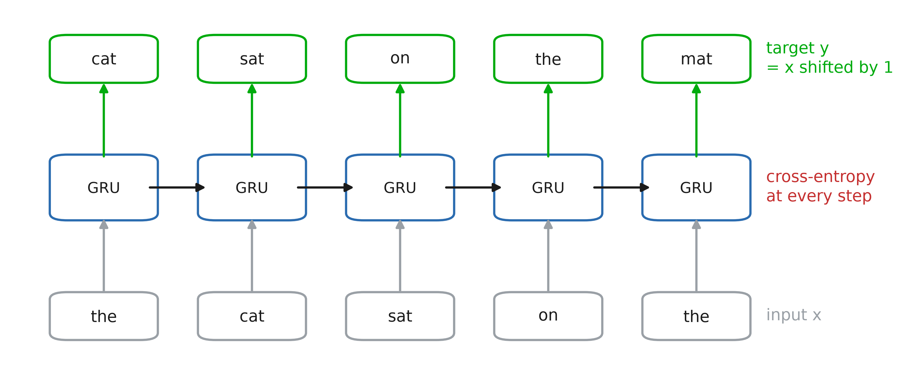

::: notes
The target is the input shifted by one word. At every position the network outputs
a probability for every word of the vocabulary, and we take the cross-entropy with
the word that actually comes next. One sequence of 32 words gives 32 training
examples, and no labels are needed: the text is its own supervision.
:::

## Perplexity
```text
perplexity = exp(cross-entropy)

```

- How many words the model hesitates between
- Uniform guess over 10 001 words: 10 001
- Perfect model: 1

::: notes
The cross-entropy is in nats, which is hard to read; its exponential is on an
intuitive scale. A perplexity of 150: the model is as unsure as if it picked
uniformly among 150 words. Accuracy (is the top word the right one?) is also
reported, but it ignores how much probability the right word got. Caveat: a smaller
vocabulary (more words mapped to UNK) makes the task easier, so perplexities are
only comparable on the same vocabulary and the same test text.
:::

## Perplexity

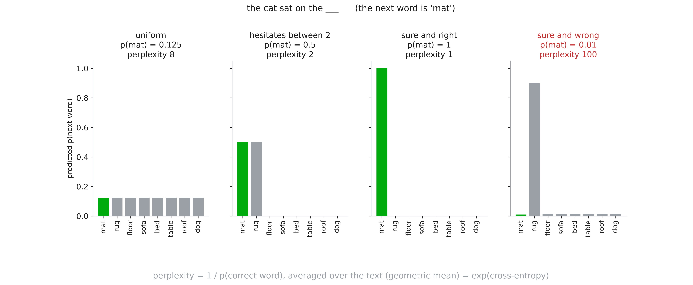

::: notes
For one word, perplexity is 1 / p(correct word). Uniform over 8 words: 8, the model
hesitates between 8. Between 2 words: 2. Sure and right: 1, the best possible. Sure
and wrong: 100 — a confident mistake costs far more than hesitation, which is why the
cross-entropy (and so the perplexity) punishes over-confidence. Over a text, it is the
geometric mean of 1 / p(correct word) over all positions, i.e. exp(cross-entropy).
:::

## RNN: one-hot encodings vs embeddings

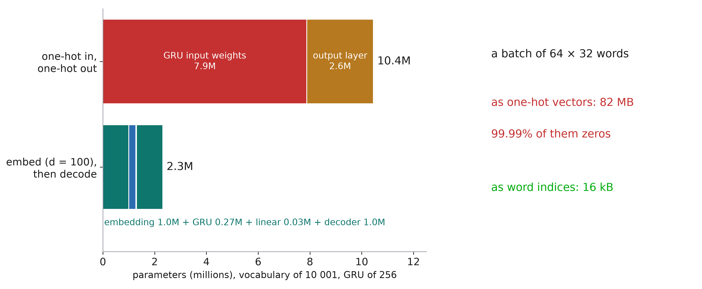

::: notes
10.4M parameters against 2.3M: the first and the last layers are huge. Going
through a vector of size 100 on both sides divides the model by 4.5. And the input
is 99.99% zeros — 82 MB for one batch, where the word indices take 16 kB.
:::

## RNN: one-hot encodings vs embeddings

```python
def n_params(*modules):
    return sum(p.numel() for m in modules
               for p in m.parameters())

V = 10_001  # vocabulary size
one_hot = [nn.GRU(V, 256),
           nn.Linear(256, V)]
embedded = [nn.Embedding(V, 100),
            nn.GRU(100, 256),
            nn.Linear(256, 100),
            nn.Linear(100, V)]
n_params(*one_hot), n_params(*embedded)
```

## Embedding of one-hot selects a column

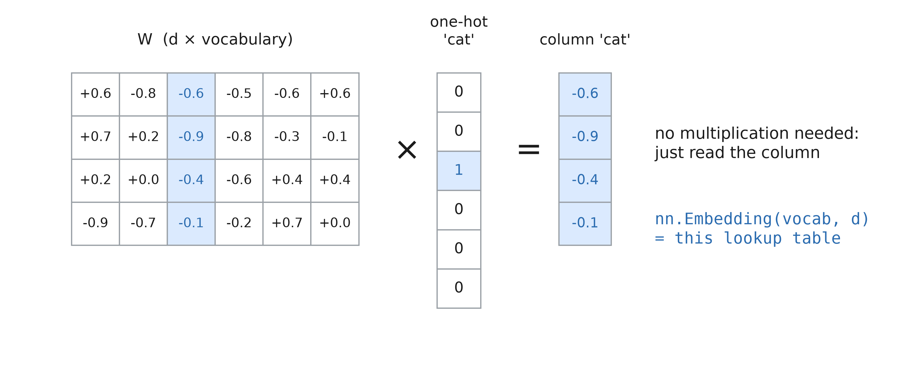

::: notes
Multiplying a one-hot vector by a matrix just reads one column. So a linear layer on
one-hot inputs is a lookup table.
:::

## Reminder: Continuous Bag of Words

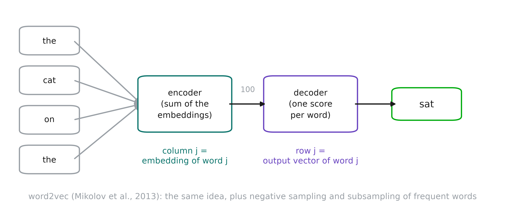

::: notes
Reminder. CBOW predicts a word from its context; the encoder's column j is the
embedding of word j. It also learns a decoder: from a vector of size 100 to a score
per word — exactly the two pieces our language model needs. word2vec (Mikolov et
al., 2013) is the official version of the same idea, with tricks that make it much
better and much faster: negative sampling (push the right word up and 5 random words
down, instead of a softmax over 10 001 words), and subsampling of very frequent words
like "the". We use gensim's implementation.
:::

## The model

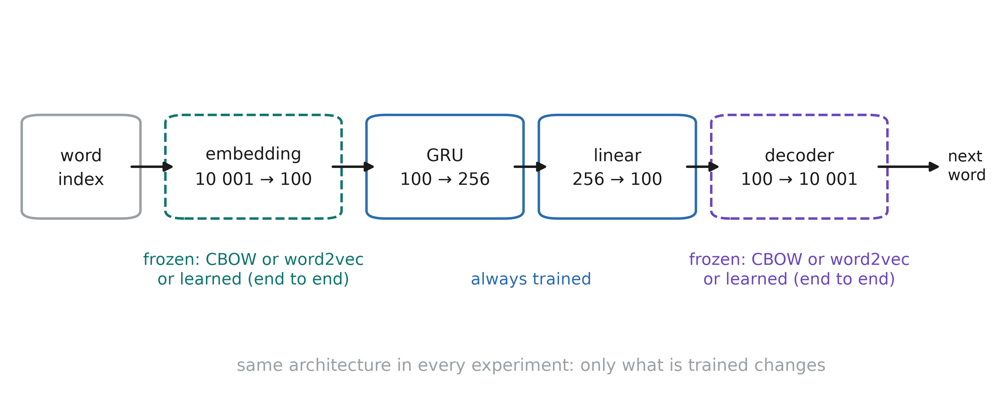

::: notes
Three experiments, one architecture. Frozen: embedding and decoder come from CBOW or
from word2vec and are not trained; only the GRU and the small linear layer are.
End to end: same layers, random initialisation, everything trained on the
next-word task.

One detail for word2vec: its decoder has no bias. With negative sampling, the score
approximates log p(w | context) − log p(w), up to a constant, so we add the fixed
bias log p(w), the frequency of each word. That turns the scores into
log-probabilities without training anything.
:::


## Takeaways

- RNNs share weights across time
- GRU/LSTM better handle long sequences
- Instead of one-hot vectors, use embeddings
- word2vec: a cheap, clean, reusable one
- Pre-training is usefull when more data is available
