# Datasets in PyTorch

## From files to batches

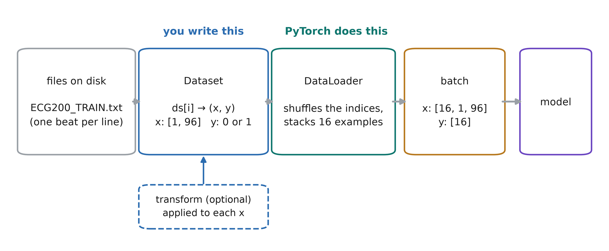

::: notes
Three pieces. The Dataset knows how to read one example: given an index i, it returns
the pair (x, y) as tensors. The DataLoader does the rest: shuffles the indices, calls
the Dataset 16 times, stacks the results into a batch. The training loop only ever
sees batches. We write the Dataset; PyTorch gives the DataLoader.
:::

## The raw data: ECG200

```bash
$ head -n 2 ECG200_TRAIN.txt
  -1.0000000e+00   5.0205548e-01 ...
   1.0000000e+00   1.4769436e-01 ...
```

- One heartbeat per line, 1 + 96 numbers
- First column: the label (−1 infarction, 1 normal)
- 100 training beats, 100 test beats

::: notes
The UCR time series archive (timeseriesclassification.com) ships each dataset as
plain text: whitespace-separated, the class in the first column, the signal in the
others. Already z-normalised beat by beat. Labels −1 and 1 are not what
cross-entropy wants (0 … n−1): the Dataset will fix that.
:::

## The Dataset protocol

```python
from torch.utils.data import Dataset

class MyDataset(Dataset):
    def __init__(self, ...):
        ...  # read / index the data

    def __len__(self):
        ...  # number of examples

    def __getitem__(self, i):
        ...  # example i, as tensors
        return x, y
```

::: notes
That is the whole contract: two methods. `len(ds)` and `ds[i]`. The DataLoader only
uses these two, so anything that implements them can be batched, shuffled, split.
Python calls them "dunder" methods: `ds[i]` is `ds.__getitem__(i)`.
:::

## ECGDataset: reading the file

```python
class ECGDataset(Dataset):
  def __init__(self, path,
               transform=None):
    self.transform = transform
    data = np.loadtxt(path,
               dtype=np.float32)
    self.signals = torch.tensor(
               data[:, 1:])
    self.classes = sorted(
        np.unique(data[:, 0]))
    self.labels = torch.tensor(
        np.searchsorted(
          self.classes, data[:, 0]))
```

::: notes
The file is small (100 × 97 numbers), so we read everything once in `__init__`.
float32, because PyTorch's default is float32 and numpy's is float64. The labels
−1, 1 become 0, 1: `classes` is the sorted list of the values found in the file and
`searchsorted` gives each label its position in that list. The same code works on
ECG5000, whose labels are 1 … 5.
:::

## ECGDataset: one example

```python
  def __len__(self):
    return len(self.labels)

  def __getitem__(self, i):
    x = self.signals[i].unsqueeze(0)
    if self.transform:
      x = self.transform(x)
    return x, self.labels[i]

ds = ECGDataset("ECG200_TRAIN.txt")
len(ds)          # 100
x, y = ds[0]
x.shape, y       # [1, 96], 0
```

::: notes
`unsqueeze(0)` adds the channel dimension: one heartbeat is a signal with one
channel and 96 time steps, [1, 96], as a grey image is [1, H, W]. The transform is
optional, applied to the signal only, every time an example is read. Ask the room:
why apply it here and not in `__init__`?
:::

## DataLoader

```python
from torch.utils.data import DataLoader

loader = DataLoader(ds, batch_size=16, shuffle=True)
for x, y in loader:
    print(x.shape, y.shape)
    break
# [16, 1, 96] [16]
len(loader)  # 7 batches (100 / 16)
```

- `shuffle=True` for training only
- `num_workers=4`: load in parallel
- `drop_last=True`: no small last batch

::: notes
The default "collate" function stacks the 16 tensors along a new first dimension:
[1, 96] sixteen times becomes [16, 1, 96]. The last batch has 100 − 6 × 16 = 4
examples. num_workers starts processes that call `__getitem__` while the GPU is
busy: essential when reading is slow (images from disk), useless here.
:::

## Load everything, or one at a time?

- Small data: read all in `__init__`
    - ECG200: 100 × 96 floats
- Large data: read files in `__getitem__`
    - `__init__` only lists the files
    - like `ImageFolder` (Session 9)

::: notes
ImageNet is 150 GB: it does not fit in memory, so `__init__` stores the list of file
paths and labels, and `__getitem__` opens one image. The DataLoader's workers hide
the cost. The training loop does not change at all between the two designs: that is
the point of the abstraction.
:::

## Transforms

```python
class RandomShift:
    def __init__(self, max_shift=10):
        self.max_shift = max_shift

    def __call__(self, x):
        s = torch.randint(
            -self.max_shift,
            self.max_shift + 1, ()).item()
        return torch.roll(x, s, dims=-1)

train = ECGDataset("ECG200_TRAIN.txt",
            transform=RandomShift())
```

::: notes
A transform is any callable: a function, or an object with `__call__` when it has
parameters. Same design as torchvision (`transforms.RandomHorizontalFlip`), and it
can go in a `transforms.Compose` with others. `torch.roll` shifts circularly: what
leaves on the right comes back on the left. Because it runs in `__getitem__`, each
epoch sees a different shift of the same beat: data augmentation for free.
:::

## Transforms

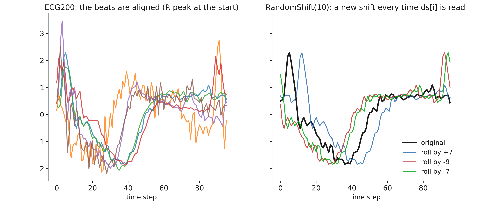

::: notes
Left: the ECG200 beats are aligned, the R peak at the start. Real recordings are not
cut so neatly: the same beat a few steps later is still the same beat. Right: the
same beat, read three times. We will use this transform twice: to build a misaligned
test set, and to augment the training set.
:::

# Convolutions in 1D

## 1D signals

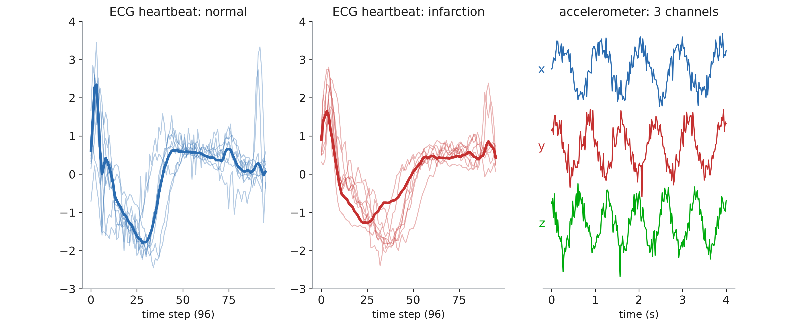

::: notes
A signal: values along one axis, time. One channel for an ECG lead, three for an
accelerometer, twelve for a clinical ECG, two for stereo audio. Same structure as an
image, with one spatial dimension instead of two: neighbouring samples are related,
and the same pattern (a peak, a slope) can appear anywhere.
:::

## From 2D to 1D

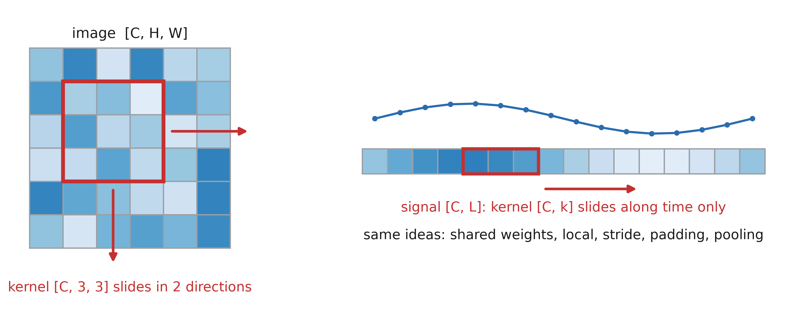

::: notes
Everything from the image sessions carries over: the kernel is shared across
positions, it only looks at a small window, and we stack conv, ReLU, pooling. The
only change: the kernel slides along one axis. An input [C, L], a kernel [C, k].
:::

## Computing a 1D convolution

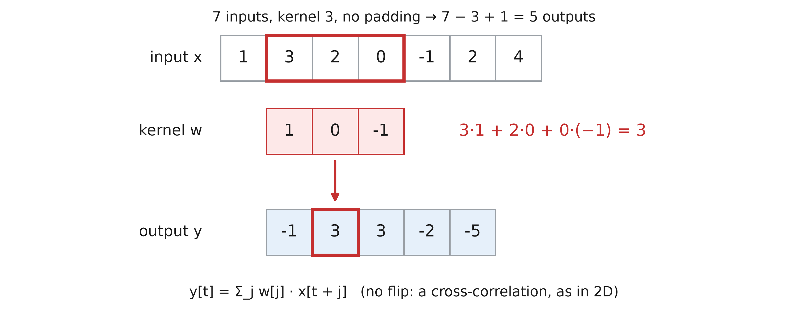

::: notes
Slide the kernel, multiply element-wise, sum. Like in 2D, deep learning
"convolutions" do not flip the kernel (strictly, a cross-correlation); since the
kernel is learned, it does not matter. Ask the room before the next slide: what is
the output length with padding 2? With stride 2?
:::

## Output length

```python
def L_out(L, k, p=0, s=1):
    return (L + 2*p - k) // s + 1

L_out(96, 5)            # 92
L_out(96, 5, p=2)       # 96, "same"
L_out(96, 5, s=2)       # 46
L_out(96, 5, p=2, s=2)  # 48
```

::: notes
The same formula as in 2D, applied to one axis. padding="same" picks p = (k−1)/2 so
the length does not change (stride 1 only). The kernel fits L + 2p − k + 1 times,
stride s keeps one position in s.
:::

## Channels

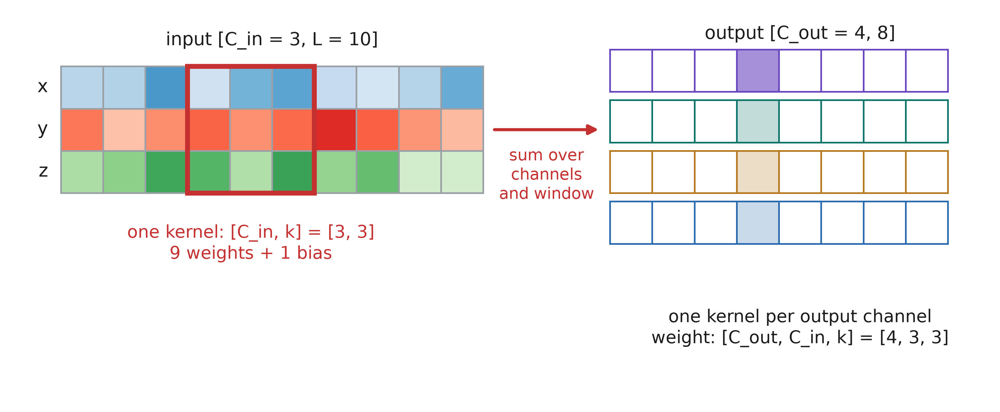

::: notes
With several input channels, the kernel covers all of them: [C_in, k] weights, and
the output at t sums over channels and over the window. One kernel gives one output
channel; C_out kernels give C_out channels. The weight tensor is [C_out, C_in, k]:
parameters C_out × C_in × k + C_out, independent of the signal length.
:::

## nn.Conv1d

```python
conv = nn.Conv1d(in_channels=1,
                 out_channels=16,
                 kernel_size=7,
                 padding="same")
conv.weight.shape  # [16, 1, 7]

x = torch.randn(64, 1, 96)
conv(x).shape      # [64, 16, 96]
```

- Shape: `[batch, channels, length]`

::: notes
The trap of the day. Conv1d wants channels before time, like Conv2d wants [B, C, H,
W]. nn.RNN with batch_first=True, last session, wanted features last. Feeding
[64, 96, 1] to a Conv1d(1, ...) is an error; feeding [64, 96, 12] to a Conv1d(96, ...)
is not — it runs and is silently wrong. Mixing convolutions and recurrent layers
needs a transpose between them.
:::

## A hand-made kernel

```python
conv = nn.Conv1d(1, 1, 3, padding=1,
                 bias=False)
with torch.no_grad():
    conv.weight[:] = torch.tensor(
        [[[-0.5, 0.0, 0.5]]])

x, _ = ds[0]
slope = conv(x.unsqueeze(0))
rising = torch.relu(slope)
```

::: notes
Before learning kernels, set one by hand. [−0.5, 0, 0.5] computes (x[t+1] − x[t−1])
/ 2: a discrete derivative. ReLU then keeps only where the signal goes up. Ask the
room what the two outputs look like before the next slide.
:::

## A hand-made kernel

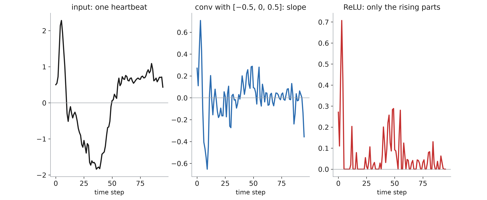

::: notes
The slope is large and positive on the R peak's rise, large and negative on its
fall, and small elsewhere. After ReLU: a "rising edge detector", which fires at the
same place whatever the position of the beat. A trained network learns such
detectors on its own: 16 of them in its first layer.
:::

## A 1D CNN for heartbeats

```python
model = nn.Sequential(
    nn.Conv1d(1, 16, k, padding="same"), # keeps shape
    nn.ReLU(), # classic non-linearity
    nn.MaxPool1d(2), # halve the length
    nn.Conv1d(16, 32, k, padding="same"),
    nn.ReLU(),
    nn.MaxPool1d(2),
    nn.Conv1d(32, 32, k, padding="same"),
    nn.ReLU(),
    nn.AdaptiveAvgPool1d(1), # averages each channel over all time steps
    nn.Flatten(),
    nn.Linear(32, 2)
)
```

::: notes
The usual pattern of image CNNs, in 1D: conv + ReLU blocks, pooling to halve the
length, more channels deeper. The end is new: AdaptiveAvgPool1d(1) averages each
channel over all time steps, whatever the length. 11k parameters for k = 7, against
6k for an MLP 96 → 64 → 2.
:::

## Shapes through the network

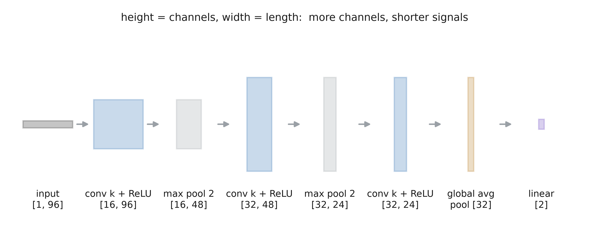

::: notes
Read the shape trace from left to right: the batch dimension is omitted. Ask the
room: what happens to this network if the beats have 140 time steps instead of 96
(ECG5000)? Nothing: only the last conv sees a different length, and the average
removes it. With a Flatten instead, the Linear layer would need 32 × 24 inputs and
would break.
:::

## Receptive field

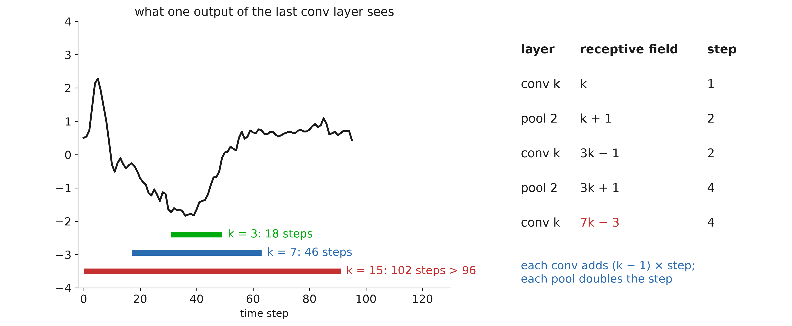

::: notes
How much of the beat does one value of the last layer depend on? Each conv adds
(k − 1) times the current step between positions, each pooling doubles that step.
k = 3: 18 steps, a fifth of the beat. k = 15: more than the whole beat. Too small and
the network cannot see the shape of the beat; this is the 1D version of the
receptive field of image CNNs, and the reason k = 3 does worst in the notebook.
:::

## Global average pooling

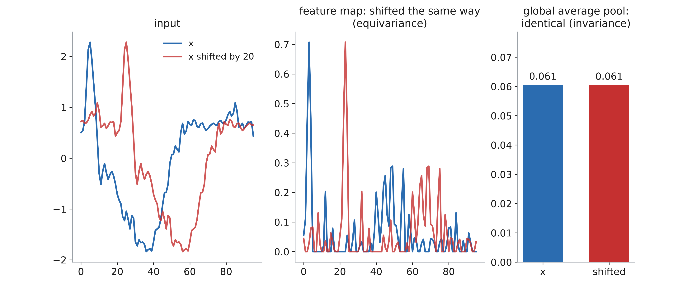

::: notes
Shift the input: the conv layers' feature maps shift by the same amount
(equivariance: a convolution is the same at every position). Then average over time:
the position disappears (invariance). A Flatten + Linear would give a weight to
each position: shifted beats would look like new inputs. That is the inductive bias
we pay for with convolutions.
:::

## Dilated convolutions

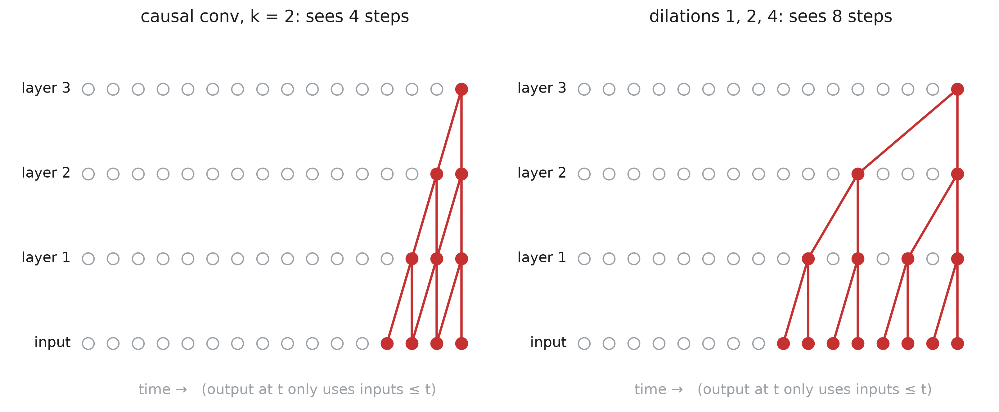

::: notes
Two variants used for long sequences (audio, forecasting). Causal: pad only on the
left, so the output at t only uses the past — needed to predict the future. Dilated:
the kernel skips d − 1 samples; doubling d at each layer makes the receptive field
grow exponentially with depth, not linearly. In PyTorch: nn.Conv1d(..., dilation=d).
WaveNet (van den Oord et al., 2016) and temporal convolutional networks (Bai, Kolter,
Koltun, 2018), which match LSTMs on many sequence tasks.
:::

## 1D CNN or RNN?

- CNN: all time steps in parallel, fast
- CNN: fixed receptive field
- RNN: one step at a time, slow
- RNN: unbounded memory, in theory
- Short, local patterns: start with a CNN

::: notes
For a heartbeat, a sound event, a sensor window, the useful patterns are local and
the signal has a fixed length: a CNN is simpler, faster to train and usually as good.
For long dependencies (text, long histories), RNNs and now transformers. Many
models mix them: convolutions first to shorten the signal, then a recurrent layer
or attention.
:::
